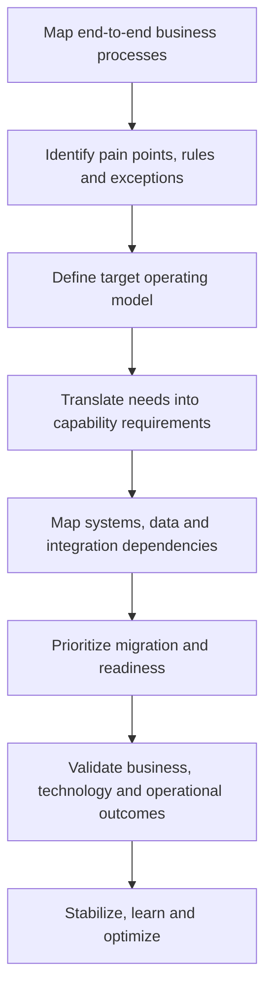

# 02 — Operating Model & Platform Transformation
[← Previous: Context](01-transformation-context.md) · [Next: Customer Experience & Commerce →](03-customer-experience-commerce.md)

## Why operating-model understanding comes first

A reservation platform does not operate in isolation. It depends on commercial policies, product definitions, inventory, pricing, payment rules, customer data, loyalty eligibility and property fulfillment.

The first task is to understand the end-to-end process: what the customer or associate is trying to do, which business rules apply, which teams own each decision, and what must happen across systems for the outcome to be reliable.

## Transformation sequence

## Workstream 1 — Process and operating model

### Key activities
- Map customer-facing and associate-facing processes.
- Identify handoffs, manual work, duplicate effort and exceptions.
- Define process ownership, decision rights and escalation paths.
- Distinguish global standards from legitimate local variation.
- Document operational dependencies that affect customer promises.
- Establish readiness, training and transition requirements.

### Key deliverables
- Current-state and target-state process maps.
- Role and responsibility matrix.
- Business rules and exception inventory.
- Target operating-model principles.
- Operational readiness and transition checklist.

### Product leadership question
What must change in the way the business works for the future product experience to be deliverable—not just technically possible?

## Workstream 2 — Reservation platform migration

### Key activities
- Translate process requirements into business capabilities.
- Separate required launch capabilities from later enhancements.
- Map dependencies across reservation, product data, pricing, inventory, payment, loyalty and property operations.
- Define migration, integration, data and reconciliation requirements.
- Track business decisions, design gaps, risks and cross-team dependencies.
- Validate end-to-end scenarios, including failure and recovery paths.

### Capability map

| Capability domain | What it enables | Questions to resolve |
|---|---|---|
| Search and discovery | Find relevant rooms and products | Are results understandable, relevant and available? |
| Reservation and order | Create or amend a booking or add-on purchase | Can a customer complete a coherent transaction? |
| Product catalog | Define product content, terms and eligibility | Is the product consistently described across channels? |
| Pricing and inventory | Determine price and availability | Are rules current, transparent and enforceable? |
| Payments and adjustments | Collect, refund or reconcile payments | Are payment responsibilities and exceptions clear? |
| Loyalty | Apply eligible benefits and earnings | Are rules transparent and correctly executed? |
| Property fulfillment | Deliver the purchased service | Can the property see and fulfil the commitment? |
| Data and reporting | Monitor journeys and outcomes | Can teams diagnose performance and exceptions? |

## Workstream 3 — Governance and execution

A useful governance model connects decisions to outcomes.

| Governance mechanism | Purpose |
|---|---|
| Product / business decision log | Record decisions, rationale, owner and due date |
| Dependency map | Make cross-workstream sequencing visible |
| Scope and release criteria | Define what is required for launch versus later |
| End-to-end scenario reviews | Validate complete journeys across teams and systems |
| Readiness reviews | Confirm operations, communications, support and training |
| Outcome review | Connect delivery progress with customer and business metrics |

## Definition of done

A capability should not be considered ready simply because development is complete. Confirm that:

- The business rule is approved and documented.
- Product content, pricing and availability are accurate.
- The customer journey handles success, failure and recovery.
- Property or service teams can fulfil the commitment.
- Loyalty and payment implications are addressed where relevant.
- Support, communication, training and reporting are ready.
- Success metrics and monitoring are in place.

## Leadership takeaway

**Platform transformation is a business change program enabled by technology.** Process understanding helps translate the business problem into a coherent set of product capabilities, delivery decisions and operational changes.

[Next: Customer Experience & Commerce →](03-customer-experience-commerce.md)
