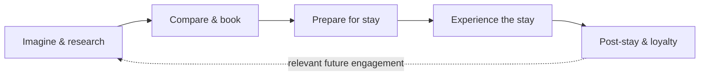

# 03 — Customer Experience & Digital Commerce
[← Previous: Operating Model & Platform](02-operating-model-platform.md) · [Next: Product Marketing & GTM →](04-product-marketing-gtm.md)

## Design around the guest lifecycle

A digital commerce experience should help customers move from intent to a confident purchase, then connect the purchase to the service they receive and the relationship that follows.

## Journey design principles

### 1. Discover
Help guests find options that match their needs.

- Use clear categories, filters and descriptive product attributes.
- Make important differences between room options easy to compare.
- Keep search results consistent with actual availability.
- Avoid presenting products that cannot be purchased for the selected context.

### 2. Evaluate
Give customers the information required to make a decision.

- Explain what is included and what costs extra.
- Display restrictions, eligibility and cancellation terms before purchase.
- Clarify whether an option is guaranteed, requested or subject to availability.
- Make loyalty benefits and applicable conditions understandable.

### 3. Purchase
Make it possible to complete the intended transaction without unnecessary friction.

- Present room and eligible add-on choices at relevant moments.
- Preserve selected options and pricing through checkout.
- Explain payment timing and cancellation rules.
- Provide clear confirmation of what has been purchased.

### 4. Prepare
Use pre-arrival engagement to help customers manage their upcoming stay.

- Present relevant eligible options, such as arrival-time or departure-time services.
- Explain availability and fulfillment conditions.
- Avoid offering a service when the property cannot reliably deliver it.
- Provide a clear way to review or change a selection.

### 5. Experience
Connect digital commitments to property operations.

- Ensure associates can see relevant reservation details and purchased services.
- Make service requests and exceptions visible to the right teams.
- Provide a consistent recovery path when a purchased service cannot be delivered.
- Capture feedback without making the guest repeat information unnecessarily.

### 6. Return and loyalty
Reinforce the relationship after the stay.

- Explain eligible loyalty earnings and benefits.
- Communicate relevant information at appropriate moments.
- Use customer feedback to identify journey friction.
- Personalize future engagement only when the data and consent rules permit it.

## Product portfolio: room and non-room

A broader commerce proposition can include several product types. The examples below are illustrative.

| Product family | Example | Customer value | Operational dependency |
|---|---|---|---|
| Room choice | View, bed type, floor or other attributes | Better fit to preferences | Accurate attributes and inventory |
| Premium room | Upgrade to a higher-value room | More choice and comfort | Eligibility, pricing and room availability |
| Connecting rooms | Rooms intended to connect | Planning confidence for families or groups | Correct inventory association and guaranteed fulfillment |
| Arrival / departure | Early arrival or later departure option | Greater schedule flexibility | Property readiness and capacity |
| Dining / amenities | Breakfast or lounge access | Convenience and clearer trip planning | Product terms, capacity and service fulfillment |
| Loyalty benefit | Eligible upgrade or member benefit | Recognition and value | Accurate member status and benefit rules |

## Customer experience guardrails

Commercial goals should not undermine trust.

- **Transparency:** show price, eligibility, terms and restrictions before purchase.
- **Relevance:** present offers that fit the journey and customer context.
- **Availability:** do not imply a product is guaranteed when it is not.
- **Consistency:** align digital information with associate and property workflows.
- **Recoverability:** explain what happens when the service cannot be fulfilled.
- **Privacy:** use personal data in line with consent, policy and applicable law.

## Experience measurement

Measure the whole journey, not only the booking conversion.

| Journey stage | Example metric | What it helps diagnose |
|---|---|---|
| Discover | Search success rate | Whether customers find relevant options |
| Evaluate | Product-detail engagement | Whether product information supports decisions |
| Purchase | Conversion rate | Whether the journey enables completion |
| Add-on offer | Offer acceptance / attach rate | Whether products are relevant and well presented |
| Prepare | Pre-arrival engagement | Whether customers use helpful trip-management options |
| Fulfillment | Service fulfillment rate | Whether the business delivers what it sells |
| Support | Contact or complaint rate | Where uncertainty or failure creates friction |
| Loyalty | Benefit utilization and repeat engagement | Whether benefits are understood and valued |

## Leadership takeaway

**Customer experience strategy is the bridge between platform capability and commercial value.** It ensures that the right product is discoverable, understandable, purchasable and fulfillable across the lifecycle.

[Next: Product Marketing & GTM →](04-product-marketing-gtm.md)
