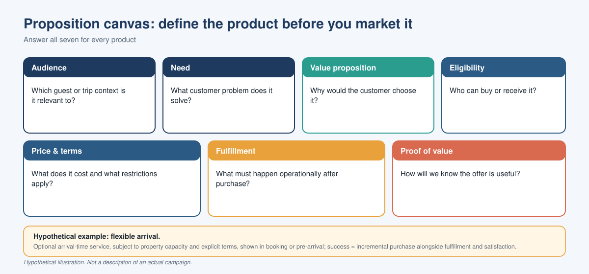
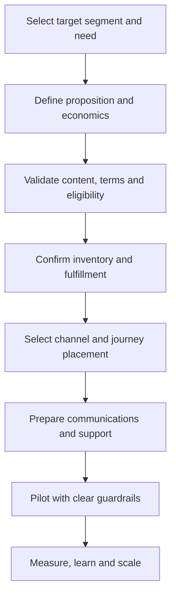
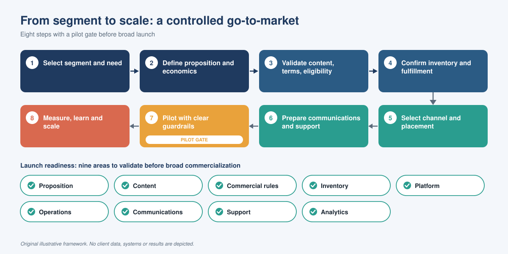

# 04 — Product Marketing & Go-to-Market
[← Previous: Customer Experience & Commerce](03-customer-experience-commerce.md) · [Next: Commercial Growth & Measurement →](05-commercial-growth-measurement.md)

## The product marketing opportunity

Product marketing translates a capability into a proposition that customers understand and the business can deliver. In digital hospitality commerce, that means deciding which products to offer, to whom, why they matter, where to present them, how to explain the terms, and how to measure adoption.

The framework below is a reusable recommendation, not a claim that every activity was executed in the original engagement.

## 1. Define the proposition

For each product, answer:

- **Audience:** Which guest or trip context is it relevant to?
- **Need:** What customer problem does it solve?
- **Value proposition:** Why would the customer choose it?
- **Eligibility:** Who can buy or receive it?
- **Price and terms:** What does it cost and what restrictions apply?
- **Fulfillment:** What must happen operationally after purchase?
- **Proof of value:** How will we know the offer is useful?

### Example proposition brief — flexible arrival

| Element | Illustrative approach |
|---|---|
| Customer need | The guest wants greater certainty around arrival timing |
| Proposition | An optional arrival-time service, subject to property capacity and explicit terms |
| Audience | Guests whose travel schedule makes arrival flexibility relevant |
| Touchpoint | Booking journey or pre-arrival communication, depending on availability and operational readiness |
| Required information | Price, eligibility, confirmation status, restrictions and service conditions |
| Operational dependency | Property readiness and a reliable way to record and fulfil the purchase |
| Success measure | Incremental purchase rate alongside fulfillment, complaints and customer satisfaction |

This is a hypothetical example. It is not a description of an actual campaign.

## 2. Build the merchandising strategy

Product merchandising should help customers understand the assortment and make a decision.

### Merchandising principles
- Use customer language rather than internal operational terminology.
- Group products by customer need or use case.
- Present meaningful differences between alternatives.
- Show total cost and material restrictions early.
- Avoid duplicative or confusing product descriptions.
- Keep product information consistent across channels.
- Do not promote products whose inventory or fulfillment path is not ready.

### Example placement logic

| Customer moment | Potential offer | Placement principle |
|---|---|---|
| Room comparison | Room attributes or premium options | Show before the customer commits, when comparison is useful |
| Booking completion | Eligible add-ons | Keep the core booking path clear and avoid distracting from completion |
| Pre-arrival | Arrival or departure flexibility | Use only when the property can validate capacity |
| During the stay | Relevant amenities or services | Match the offer to the guest's current context |
| Post-stay | Loyalty information and relevant future engagement | Reinforce value without over-messaging |

## 3. Develop a go-to-market plan

### GTM checklist

**Market and audience**
- Define the customer need and relevant segments.
- Establish eligibility and exclusion rules.
- Understand competing choices and the current customer alternative.

**Product and offer**
- Agree the proposition, price, terms and product information.
- Confirm inventory, operational capacity and fulfillment responsibilities.
- Align product naming and descriptions across channels.

**Channel and activation**
- Choose the journey moment and channel.
- Develop clear content and customer communications.
- Coordinate digital, loyalty, operations, revenue and support teams.
- Confirm launch readiness and escalation paths.

**Measurement**
- Define baseline, hypothesis and success threshold.
- Track exposure, engagement, conversion and incremental contribution.
- Monitor fulfillment, cancellations, complaints and customer satisfaction.
- Decide in advance what would trigger iteration, pause or scale.

*The flow and the nine readiness areas at a glance; the table below sets out the validation question for each area.*

## 4. Product launch readiness

A product is not ready for broad commercialization until these conditions are met.

| Readiness area | Validation question |
|---|---|
| Customer proposition | Is the value clear and credible? |
| Product content | Are descriptions, terms and restrictions complete? |
| Commercial rules | Are price and eligibility approved? |
| Inventory | Can availability be checked reliably? |
| Platform | Can the customer purchase and receive confirmation? |
| Operations | Can the property or service team fulfil the commitment? |
| Communications | Are confirmation, changes and exceptions covered? |
| Support | Can teams resolve likely questions and failures? |
| Analytics | Can exposure, purchase, fulfillment and impact be measured? |

## 5. Launch and optimization

Use a controlled pilot rather than assuming a launch will work equally well for every segment or property.

1. Choose a bounded audience and eligible product set.
2. Validate the end-to-end journey with real operational scenarios.
3. Establish a baseline or comparison group where practical.
4. Review customer and associate feedback alongside commercial metrics.
5. Fix content, eligibility, fulfillment or journey problems.
6. Expand only when customer trust and operational reliability remain healthy.

## Leadership takeaway

**Product marketing is not just campaign messaging.** It connects positioning, assortment, merchandising, channels, operational readiness and measurement so that a product can be launched and scaled responsibly.

[Next: Commercial Growth & Measurement →](05-commercial-growth-measurement.md)
