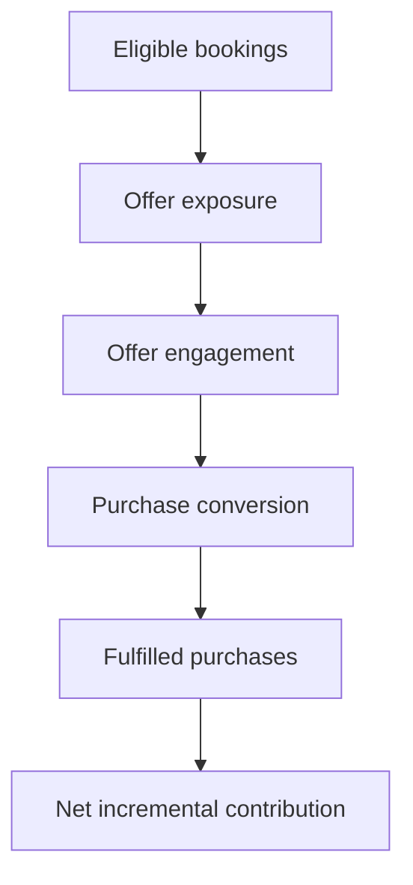

# 05 — Commercial Growth & Measurement
[← Previous: Product Marketing & GTM](04-product-marketing-gtm.md) · [Next: Leadership Lessons →](06-leadership-lessons.md)

## From product capability to commercial outcome

Digital commerce creates potential value through better product discovery, relevant offers, lower purchase friction, and stronger fulfillment. The business case should make the causal logic explicit and avoid treating every projected opportunity as incremental revenue.

## Opportunity prioritization framework

Score each opportunity against five dimensions. The weights and scoring model below are a suggested template, not historical program criteria.

| Dimension | Question |
|---|---|
| Customer value | Does it solve a meaningful customer problem? |
| Commercial potential | Is there a credible path to incremental contribution? |
| Feasibility | Are platform, data and integration dependencies manageable? |
| Operational readiness | Can the product be fulfilled consistently? |
| Strategic fit | Does it support the target customer experience and longer-term platform direction? |

A simple prioritization score can be calculated as:

`Priority score = Customer value + Commercial potential + Feasibility + Operational readiness + Strategic fit`

Use a consistent rating scale, such as 1–5, and document the evidence behind each score. If risk or effort needs to influence prioritization, add it explicitly rather than hiding it inside a subjective score.

## Build a transparent commercial model

For an illustrative ancillary product, a simple funnel might be:

### Example formulas

- **Offer exposure rate** = eligible bookings shown the offer ÷ eligible bookings
- **Engagement rate** = offer interactions ÷ offer exposures
- **Purchase conversion** = purchases ÷ offer exposures
- **Attach rate** = bookings with the add-on ÷ eligible bookings
- **Fulfillment rate** = fulfilled purchases ÷ purchases
- **Net incremental contribution** = incremental revenue − variable costs − discounts − refunds − incremental service costs

These formulas are illustrative. The exact denominator and accounting treatment should be agreed before measurement begins.

## Measurement framework

| Dimension | Example KPIs | Guardrail |
|---|---|---|
| Acquisition and discovery | Search success, product-detail views, offer exposure | Do not inflate exposure with irrelevant impressions |
| Conversion | Booking conversion, add-on conversion, checkout abandonment | Protect core booking completion |
| Revenue quality | Average order value, attach rate, incremental contribution | Separate gross sales from incremental value |
| Fulfillment | Fulfillment rate, cancellation, refund and exception rate | Do not scale an offer that cannot be delivered reliably |
| Customer experience | CSAT, complaints, contact rate, review themes | Monitor trust and customer friction |
| Loyalty | Eligible benefit utilization, engagement and repeat behavior | Apply eligibility and privacy rules correctly |
| Operations | Manual intervention, handling time, exception volume | Avoid shifting digital friction to hotel teams |
| Platform | Error rate, latency, availability and data quality | Maintain reliability during commercialization |

## Illustrative experiment

**Hypothesis:** Showing a relevant, clearly explained add-on at an appropriate point in the customer journey will increase purchase without materially reducing core booking conversion or customer satisfaction.

### Test design
- Define eligible customers and exclusions.
- Compare a control journey with a variant journey where feasible.
- Keep pricing, terms and inventory rules consistent.
- Define the primary metric and guardrails before launch.
- Review performance by relevant segments, while avoiding unsupported conclusions from small samples.

### Decision rules
- **Scale:** conversion and incremental contribution improve while fulfillment and customer guardrails remain healthy.
- **Iterate:** engagement is strong but purchase is weak, suggesting a proposition, price, content or checkout issue.
- **Pause:** fulfillment problems, complaints, refunds or core-booking deterioration exceed agreed thresholds.

No test result is claimed here; this is a proposed experiment template.

## Avoid common measurement mistakes

- Treating a business-case estimate as realized impact.
- Attributing all sales after launch to the new experience.
- Ignoring cannibalization, discounts, refunds and delivery costs.
- Optimizing clicks when the real objective is incremental contribution.
- Reporting adoption without checking whether the product was fulfilled.
- Comparing segments without accounting for eligibility, availability and seasonality.

## Leadership takeaway

**A credible growth strategy connects product discovery to fulfilled value.** The objective is not simply to sell more products; it is to generate incremental, sustainable value while protecting customer trust and operational reliability.

[Next: Leadership Lessons →](06-leadership-lessons.md)
