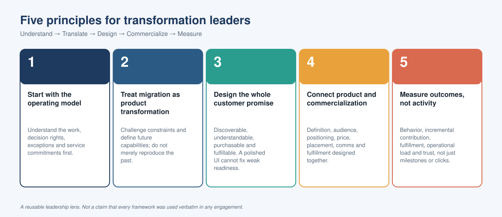

# 06 — Leadership Lessons & Reusable Tools
[← Previous: Commercial Growth & Measurement](05-commercial-growth-measurement.md) · [Back to Home →](../README.md)

## The leadership story

The central lesson from a transformation that spans operating processes, reservation technology and digital commerce is that strategic scope expands when the leader can connect the business model to the platform and the customer experience.

The progression can be summarized as:

**Understand the business → translate it into capabilities → design the experience → commercialize the proposition → measure the outcome.**

This is a reusable leadership lens, not a claim that every framework in this repository was used verbatim in the original engagement.

## Five principles



### 1. Start with the operating model
Understand the work, decision rights, exceptions and service commitments before designing the future platform.

### 2. Treat migration as product transformation
A system migration is an opportunity to challenge process constraints and define the capabilities the future business needs—not merely reproduce existing behavior.

### 3. Design the whole customer promise
A product must be discoverable, understandable, purchasable and fulfillable. A polished digital interface cannot compensate for inaccurate availability or weak operational readiness.

### 4. Connect product strategy with commercialization
Product definition, audience, positioning, pricing, channel placement, communications and fulfillment need to be designed together.

### 5. Measure outcomes, not activity
Track customer behavior, incremental contribution, fulfillment, operational load and customer trust—not only delivery milestones or clicks.

## Reusable templates

### A. Product opportunity brief

Copy this template when assessing a new product opportunity.

```text
Opportunity:
Target customer:
Customer problem:
Current alternative:
Proposed proposition:
Eligibility:
Pricing and terms:
Customer journey placement:
Required platform capabilities:
Inventory and fulfillment dependencies:
Operational owner:
Commercial hypothesis:
Primary KPI:
Customer and operational guardrails:
Key risks:
Pilot design:
Scale / iterate / stop criteria:
```

### B. Cross-functional decision log

| Decision | Options considered | Decision owner | Dependencies | Date needed | Status |
|---|---|---|---|---|---|
| Product scope | Minimum viable scope vs. expanded scope | Business / Product | Operations, platform, commercial rules | To be agreed | Open |
| Journey placement | Booking vs. pre-arrival vs. in-stay | Product / Digital | Eligibility, availability, UX | To be agreed | Open |
| Fulfillment model | Automated vs. associate-assisted | Operations | Inventory, property processes | To be agreed | Open |
| Measurement | Conversion, contribution and guardrails | Analytics / Finance | Event tracking, definitions | To be agreed | Open |

### C. Executive status summary

Use a concise status format for leadership reviews:

- **Outcome sought:** the customer or business result.
- **Progress:** what is complete and what evidence supports it.
- **Decision needed:** the specific choice and decision owner.
- **Risk / dependency:** the impact and mitigation.
- **Next milestone:** the deliverable, owner and date.
- **Success measure:** how the outcome will be assessed.

### D. Launch readiness checklist

- [ ] Proposition and target audience agreed
- [ ] Product content, terms and eligibility approved
- [ ] Pricing and inventory rules validated
- [ ] Purchase and confirmation journey tested
- [ ] Property or service fulfillment validated
- [ ] Exceptions, refunds and support processes documented
- [ ] Communications and training ready
- [ ] Analytics and guardrails instrumented
- [ ] Pilot and scale criteria agreed

## How this applies beyond hospitality

The same approach can be applied to:
- **Technology:** translate platform capabilities into adoptable customer-facing products.
- **Consulting:** connect process redesign, platform change and measurable business outcomes.
- **Digital media:** package content or services into clear propositions, distribute them through relevant journeys and measure conversion and retention.
- **Financial services:** connect account or trading capabilities with customer journeys, advisory workflows, engagement and responsible monetization.

## Closing perspective

The most valuable transformation leaders bridge disciplines that are often separated: operating model, technology, customer experience and commercial strategy.

The goal is to ensure that transformation delivers more than a modern platform—it creates a business that can offer the right product, to the right customer, through the right journey, and deliver on the promise.

## Disclosure

This is an independently authored portfolio framework. Any scenario, example or metric included for demonstration is illustrative unless explicitly stated otherwise. No confidential client materials or proprietary client data should be added to the public repository.
